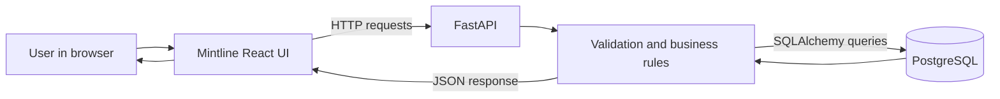

# Mintline — Visual Full-Stack Walkthrough

Mintline is a focused credit-management workspace. This walkthrough follows the user-facing journey from the public homepage to a live account read, credit changes, migration administration, and the responsive mobile workspace. Each step explains what the user sees and what the frontend, API, and database did in the verified test run.

> **Production deployment finding — 25 October 2026:** the public Vercel site returns the homepage successfully, but its deployed JavaScript bundle is configured to call `http://localhost:8000`. The Vercel project currently has no environment variables configured, so the frontend falls back to its local-development API address. A visitor's browser will therefore try to reach a backend on that visitor's own computer. The deployed production UI is **not yet verified end to end** and its API integration is blocked until the correct deployed API origin is configured as `VITE_API_BASE_URL`. The passing screenshots and results below come from the production-built frontend connected to the real FastAPI code and an isolated PostgreSQL database in GitHub Actions—not from the production database.

## The product at a glance

The application keeps a deliberately small surface area: open an existing account, read its balance, add or deduct credits, reset a balance with confirmation, and use a guarded schema-migration screen. It does not invent an account directory, user registration, or credit transaction history that the backend does not provide.

The main data tables are `users` (existing accounts), `credits` (the current balance and last-updated timestamp), and `schema_migrations` (applied schema-change records). Credit changes update the current balance; the present schema does not create a per-operation credit ledger.

## What was actually verified

The latest recorded integrated run was [GitHub Actions run 39945747732](https://github.com/faizansaiyed123/frontend-intern-credits/actions/runs/39945747732), completed on 23 October 2026. It built the production frontend, started the backend from the backend repository, created a disposable PostgreSQL database, exercised the UI in Playwright Chromium without API mocks, and checked the resulting rows directly with SQL. The run completed **18 assertions with zero failures**, observed **15 browser API responses**, and reported **zero uncaught browser JavaScript errors**.

The test account was synthetic: `user_id = 1`, starting at 120 credits. All mutation examples below ran only against that isolated test database. The screenshots are genuine Playwright captures from that run.

## 1. Start at the public homepage

The homepage introduces the purpose of the workspace and points visitors to the credit dashboard. The interface describes the actual backend capabilities rather than showing made-up account balances or invented transaction activity.

**User action:** choose **Open credit dashboard**.

**What the verified flow does:** the browser navigates to `/dashboard`. The dashboard then calls the health endpoint and requests the selected account from the API.

## 2. Open an existing account

The dashboard displays the balance, account ID, last-updated timestamp, API connection status, and the available credit operations. In the isolated test setup, account 1 began with **120 credits**.

**User action:** enter an existing numeric user ID in **Account lookup**, then choose **Open account**. The **Refresh** action checks API health and fetches the active account again.

**Full-stack evidence:**

- Browser request: `GET /healthz` → HTTP 200.
- Browser request: `GET /api/credits/1` → HTTP 200.
- PostgreSQL contained the seeded user and its starting balance before the browser journey began.

The backend does not currently offer user creation or a user-directory endpoint. An ID must already exist in the `users` table.

## 3. Add credits

The add dialog accepts a positive whole-number amount and identifies the account being changed. The UI does not treat typing into the field as a completed change; it waits for the API result.

**User action:** add 25 credits and confirm the addition.

The dashboard updates to **145 credits** after the successful response.

**Full-stack evidence:**

- Browser request: `POST /api/credits/1/add` with `{"amount":25}` → HTTP 200.
- Backend response returned the updated account balance.
- Direct PostgreSQL read-back returned **145**, matching the UI.
- Reloading the page fetched the account again and preserved the 145-credit balance.

This is a real write-and-read-back check, not an optimistic frontend-only counter.

## 4. Deduct credits

The deduction dialog shows the available balance. The UI prevents the requested amount from exceeding the currently displayed balance, and the backend independently enforces the rule so that a direct API caller cannot drive the balance below zero.

**User action:** deduct 40 credits and confirm.

The balance becomes **105 credits**.

**Full-stack evidence:**

- Browser request: `POST /api/credits/1/deduct` with `{"amount":40}` → HTTP 200.
- Direct PostgreSQL read-back returned **105**.

The backend's conditional SQL update only deducts when the stored balance is at least the requested amount. If no row is updated, it returns an insufficient-credits error.

## 5. Reset a balance deliberately

Reset is treated as a separate, consequential action. The dialog explains the effect and requires the user to check the confirmation box before the reset button can be submitted.

**User action:** confirm that the current balance should be cleared, then choose **Reset balance**.

The account balance becomes **0 credits**.

**Full-stack evidence:**

- Browser request: `PATCH /api/credits/1/reset` → HTTP 200.
- Direct PostgreSQL read-back returned **0**.
- The zero balance remained in place when the account was read again.

## 6. See backend validation and error handling

### Unknown account

When the UI requests user ID `999999`, the backend returns HTTP 404 with the message `User not found`. The dashboard displays that backend error rather than fabricating an empty account. The test then returned to the seeded account.

**Verified:** `GET /api/credits/999999` → HTTP 404; the error banner was visible in the browser.

### Invalid credit operations

The API was also called directly to ensure client-side validation is not the only guard.

| Attempt | API result | Database result |
| --- | --- | --- |
| Add zero credits | HTTP 422 from request validation | Balance stayed at 0 |
| Deduct 1 credit from a zero balance | HTTP 400, `Insufficient credits` | Balance stayed at 0 |

The frontend additionally checks that credit amounts are positive whole numbers and prevents an over-balance deduction in the dialog. The automated run directly verified the zero-amount and insufficient-balance cases; negative amounts, fractional values, extremely large values, and concurrent write races were not separately exercised.

## 7. Open the privileged migration area

The migration screen requires an administrator API key entered for the current browser session. An intentionally incorrect key was rejected by the backend and the UI displayed the actual authorization error.

**Verified:** `GET /api/schema/migrations` with an incorrect `X-API-Key` → HTTP 401.

With the run-only test key, the screen loaded migration history from PostgreSQL through the API. The key was generated only for the CI run; it is not included in this walkthrough or the network evidence.

### Apply a test migration and confirm the database result

The test submitted a harmless, test-only index creation statement through the UI. The backend executed it and inserted the migration name into `schema_migrations`.

**Full-stack evidence:**

- `POST /api/schema/apply` → HTTP 200.
- Direct SQL confirmed the test index existed.
- Direct SQL confirmed exactly one migration record existed for the supplied migration name.
- Submitting the same migration name again returned an idempotent “already applied” result; the migration table still contained exactly one matching row.

These schema changes were made in the disposable CI database, not in the production database. The migration screen can execute SQL using the database role configured on the backend, so it is a high-privilege control and should be restricted to trusted administrators. A UI confirmation is not a security boundary.

## 8. Use the workspace on a narrow screen

The production-built interface was also exercised at **390 × 844**. The account read completed at that viewport, showing that the same API-backed dashboard can render on a narrow screen.

The mobile menu opens and exposes the main navigation. The E2E run confirmed the navigation was visible and the dashboard remained API-backed.

## 9. Daily credit scheduler

The backend includes a daily scheduler set for **00:00 UTC**. Its job creates any missing credit rows for existing users and adds 5 credits to every credit row, updating the timestamp.

The integration run invoked the scheduler's actual `add_daily_credits()` function against the isolated PostgreSQL database. SQL confirmed both that an existing account's credits were incremented and that a user without a credit row received one. This verifies the scheduler logic, but the test did not wait for the real wall-clock midnight trigger or verify the scheduler in a long-running production process.

## Feature coverage and status

| Feature / workflow | Status in isolated integrated run | Evidence or boundary |
| --- | --- | --- |
| Public homepage | **Passed** | Real browser screenshot and navigation |
| Dashboard route and API health | **Passed** | `GET /healthz` returned 200 |
| Existing account lookup and balance display | **Passed** | `GET /api/credits/1`, initial balance 120 |
| Refresh and read-after-write | **Passed** | Reload re-read the stored balance |
| Add credits | **Passed** | 120 → 145; direct SQL matched |
| Deduct credits | **Passed** | 145 → 105; direct SQL matched |
| Reset with UI confirmation | **Passed** | `PATCH`; database balance became 0 |
| Zero amount validation | **Passed** | API returned 422; balance unchanged |
| Deduct beyond balance | **Passed** | API returned 400; balance unchanged |
| Unknown user | **Passed** | API returned 404 and UI showed the error |
| Migration access with incorrect key | **Passed** | API returned 401 |
| Migration history with correct key | **Passed** | API returned 200 with database-backed history |
| Apply a migration | **Passed** | Test index and migration record independently queried |
| Repeated migration name | **Passed** | Duplicate was skipped; one record remained |
| Scheduler function and missing credit row | **Passed** | Direct SQL read-back on isolated PostgreSQL |
| Mobile dashboard and navigation | **Passed** | 390 × 844 browser viewport |
| Browser JavaScript errors | **Passed** | No uncaught page errors in the run |
| Production site → deployed API → production database | **Blocked** | Production bundle targets `http://localhost:8000`; no Vercel environment variables are configured |
| Production data mutation | **Not performed** | No production database or real customer balance was changed |

## Current production blocker

The current public website is [frontend-intern-credits.vercel.app](https://frontend-intern-credits.vercel.app). The HTML is served successfully, but inspection of its deployed JavaScript revealed the compiled API origin `http://localhost:8000`. The Vercel project's environment-variable list was empty at the time of inspection on 25 October 2026.

Before production E2E can be completed, configure `VITE_API_BASE_URL` in the Vercel production environment to the **actual deployed FastAPI origin**, redeploy, and then repeat the browser flows while verifying a safe, dedicated test account in the corresponding database. The backend origin is not declared in the checked-in frontend configuration, and I have not guessed it or sent credit mutations to an unknown service.

## Important implementation boundaries

- **No login or user-ownership checks on credit endpoints:** the current backend code does not require authentication for `GET /api/credits/{user_id}`, `POST .../add`, `POST .../deduct`, or `PATCH .../reset`. Knowing an ID is not authorization. Do not treat these routes as safe for real user balances until authentication, per-user authorization, and appropriate abuse controls are added.
- **Privileged schema execution:** `POST /api/schema/apply` executes submitted SQL using the backend database role. Keep the admin key out of frontend build variables and source code, use a least-privileged database role, and restrict access to this endpoint.
- **No credit transaction ledger:** the schema stores the current balance and last-updated timestamp, not a durable audit record for each add/deduct/reset operation. The migration table is a schema-change log, not a credit history.
- **Some edge cases remain untested:** negative/fractional/very large amounts, simultaneous balance updates, database constraint failures independent of API validation, invalid SQL rollback, missing admin configuration (HTTP 503), browser offline/CORS behavior, and the production scheduled job were not verified in the recorded run.

## Evidence and source repositories

- [Integrated E2E report](INTEGRATION-REPORT.md) — assertion results and direct PostgreSQL checks.
- [Captured API network evidence](api-network.json) — observed HTTP methods, paths, statuses, and assertion records; secrets and API keys are excluded.
- [Frontend repository](https://github.com/faizansaiyed123/frontend-intern-credits)
- [Backend repository](https://github.com/faizansaiyed123/backend-intern-credits)
- [Integrated GitHub Actions run](https://github.com/faizansaiyed123/frontend-intern-credits/actions/runs/39945747732)

The recorded integrated test is a successful full-stack verification of the implemented credit workflows in an isolated environment. It does **not** establish that the current Vercel deployment can reach a deployed backend or that production database writes are working; that remains blocked by the missing production API origin.
