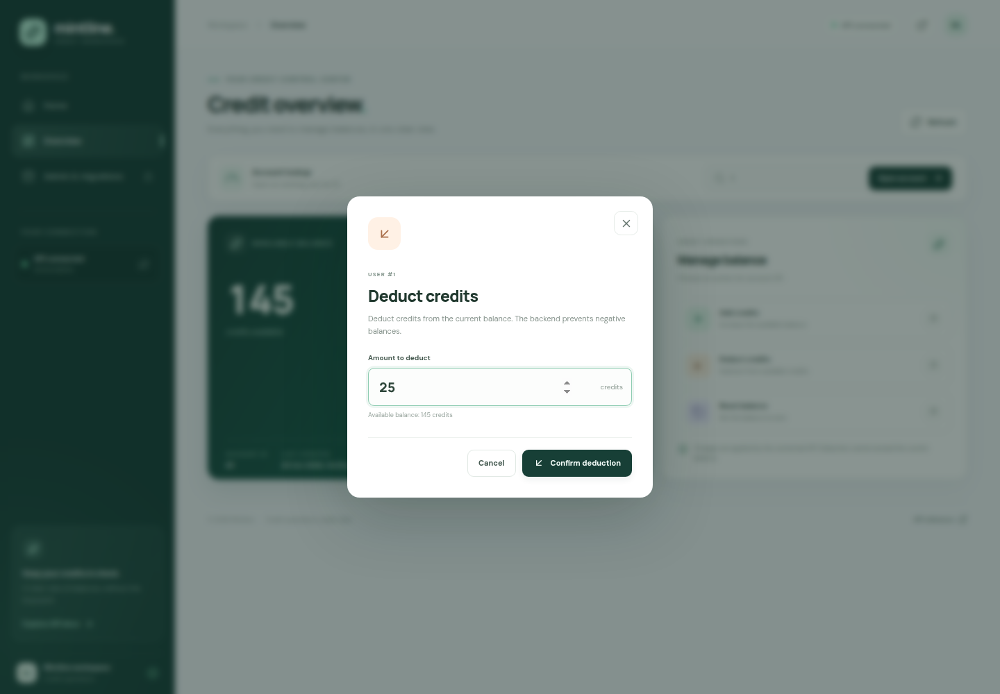
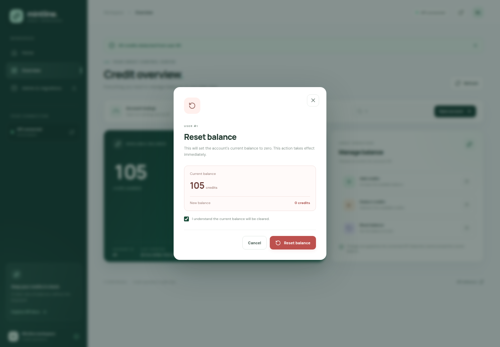
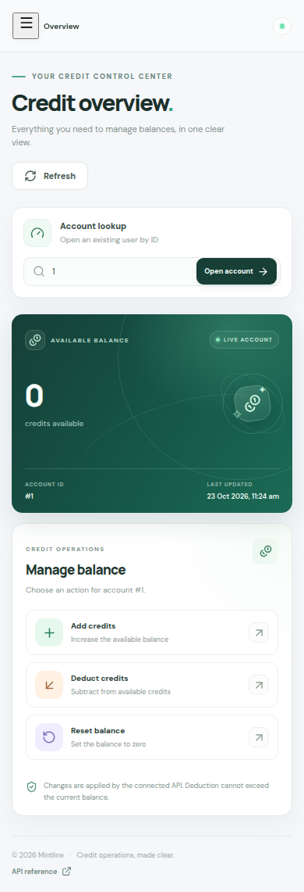
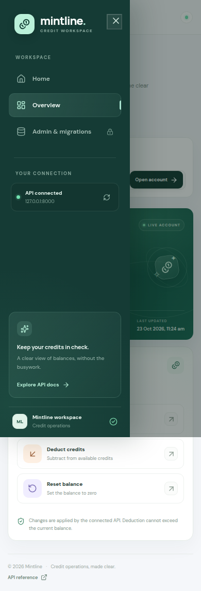

# Mintline — Credit Management Workspace

Mintline brings account balances and credit operations into a clear, focused workspace. This visual guide introduces the experience from the welcome page through account management, administrative tools, and the mobile layout.

## Welcome to Mintline

The homepage introduces Mintline's purpose and gives visitors a direct route into the workspace.

## Open your workspace

Choose **Open credit dashboard** to continue. Sign in to an existing account or create an account to get started. New accounts begin with a zero-credit balance, and each account is restricted to its own information and credit operations.

## Review your balance

The overview brings your current balance, account ID, and last-updated time together in one place. Refresh the view to retrieve the latest account information from the connected service.

## Add credits

Choose an amount and confirm the addition. Mintline sends the request to the credit service and displays the balance returned by the API.

The balance shown here moves from 120 to 145 credits after adding 25 credits.

## Deduct credits

Choose how many credits to deduct. The available balance is shown before you confirm, and deductions cannot reduce the stored balance below zero.

After deducting 40 credits from 145, the displayed balance becomes 105.

## Reset a balance

Reset is a separate action because it clears the current balance. Review the confirmation before proceeding.

Once the reset completes, the account's balance is zero.

## Schema administration

The administrator area displays recorded schema changes and provides controls for applying supported schema updates. Access requires the backend's administrator key. Migration controls are intended for trusted administrators; the backend restricts the SQL forms accepted by this screen.

## Use Mintline on mobile

The workspace adapts to a narrow screen while keeping the account balance and primary operations available.

The navigation opens as a compact menu on mobile so you can reach the workspace sections on smaller devices.

## Connected to the credit service

Mintline uses the connected FastAPI service for account reads and credit changes. PostgreSQL stores account information and current balances, while the interface displays the response returned by the service. Sign-in sessions are time-limited and can be revoked when you sign out.

## Explore the code

- [Mintline frontend](https://github.com/faizansaiyed123/frontend-intern-credits)
- [Credit management backend](https://github.com/faizansaiyed123/backend-intern-credits)
