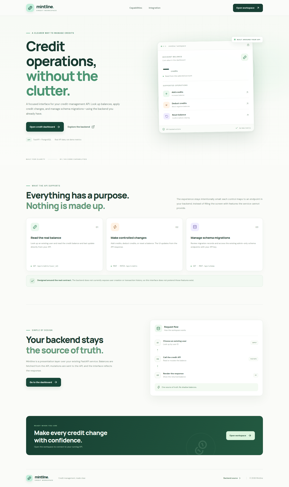
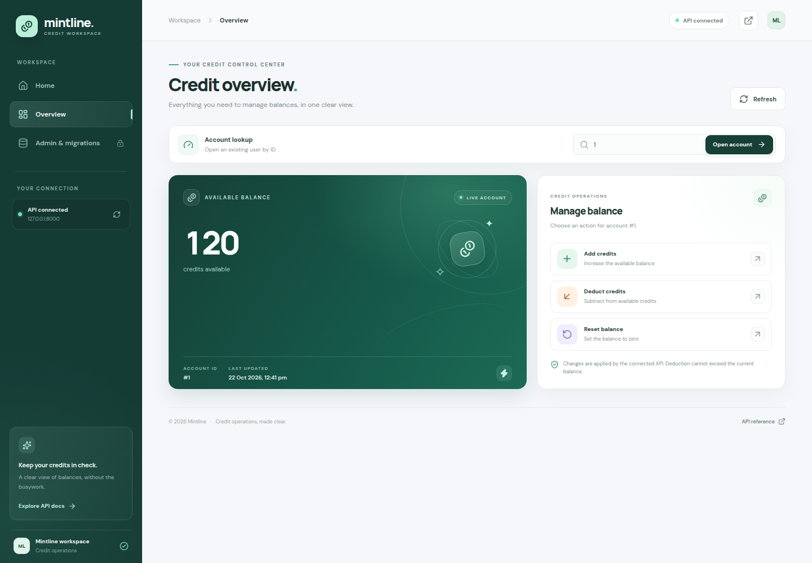
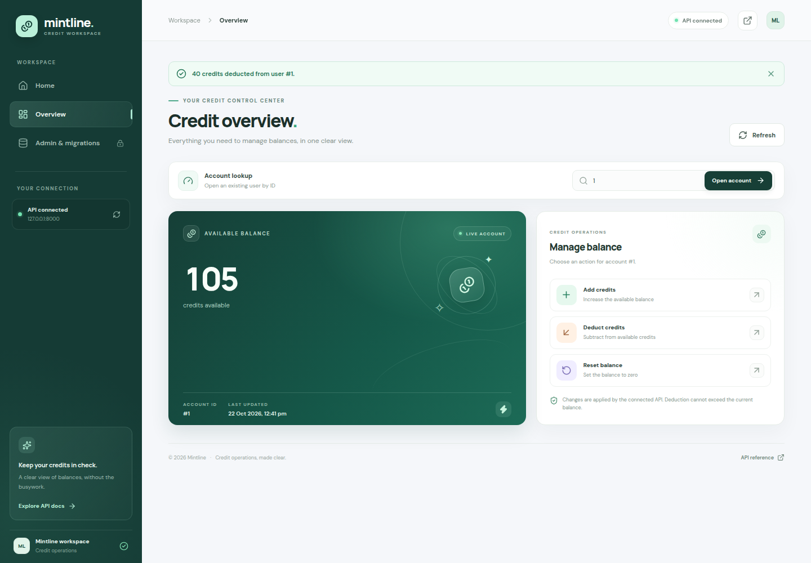
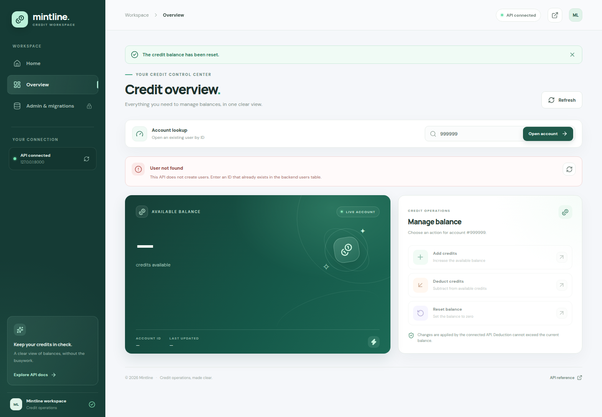
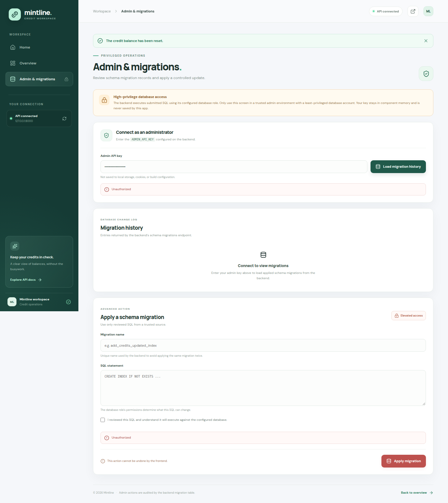
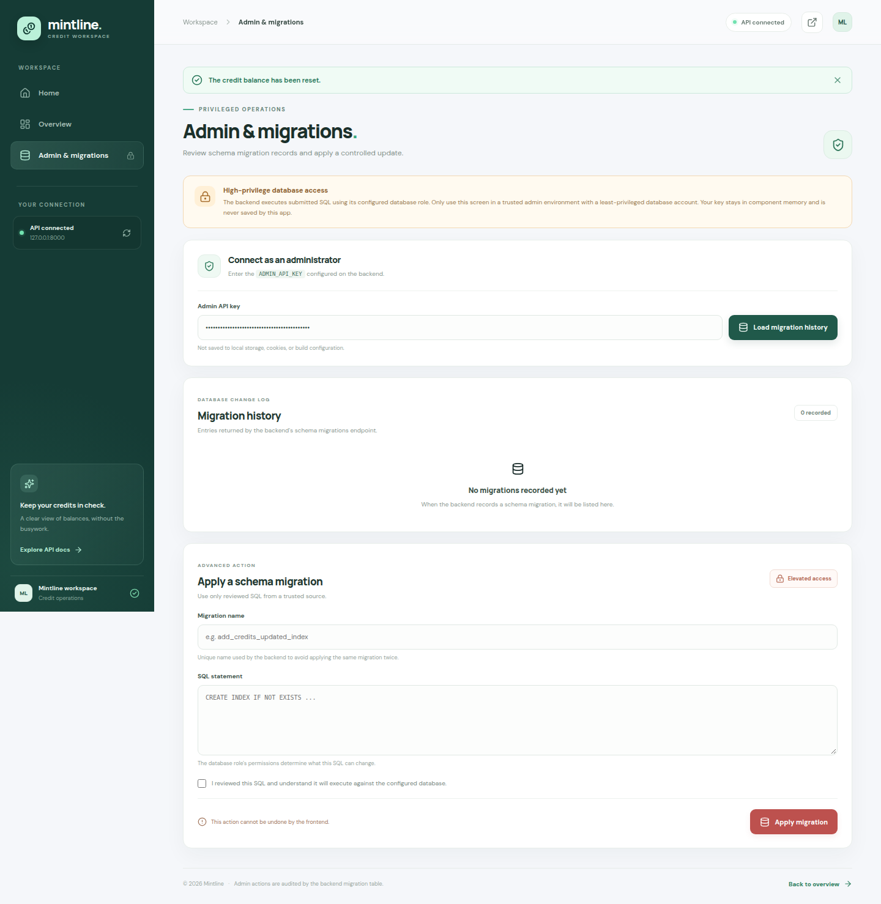
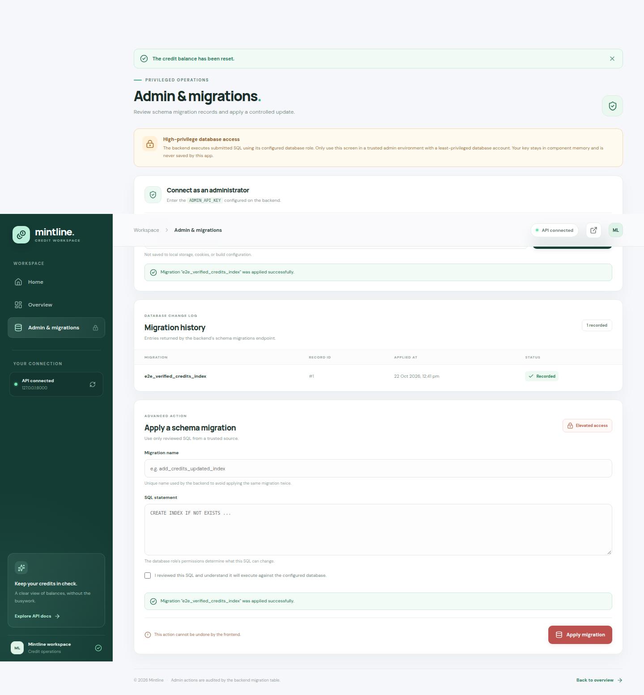

# Mintline — verified end-to-end walkthrough

Generated from the integrated browser/API/database workflow on 2026-10-22T12:41:13.770Z.

**Integration model:** a production-built React frontend makes real HTTP requests from Chromium to the repository's FastAPI backend; PostgreSQL is the backend's actual database. The run observes response codes and queries PostgreSQL after mutations. It does not mock or intercept API routes.

**Data boundary:** a disposable PostgreSQL instance and synthetic, test-only users are used. This workflow does not connect to production or use customer records.

**Result:** PASSED

## Public homepage

The public page describes the features that the backend actually exposes. Opening the workspace navigates into the operational dashboard.

## Live account and credit operations

### Live account balance

The selected account balance and last-updated timestamp are loaded from FastAPI and PostgreSQL.

### Add credits

The operation dialog accepts an amount before submitting the real add-credit API request.

### Persisted credit addition

After POST /api/credits/1/add, the UI and a direct PostgreSQL query both report 145.

### Deduct credits

The deduction dialog shows the available balance before the real backend mutation.

### Persisted credit deduction

After POST /api/credits/1/deduct, the UI and database both report 105.

### Reset confirmation

Reset requires explicit confirmation before the frontend sends PATCH /api/credits/1/reset.

### Reset persisted

The balance becomes zero through the backend endpoint and is verified directly in PostgreSQL.

## Backend errors and administration

### Backend error handling

A missing account displays the actual API 404 response as a user-facing error.

### Admin authentication guard

The frontend sends an incorrect API key and displays the backend's real 401 response.

### Migration history

With a valid runtime-only key, the frontend reads migration records from PostgreSQL through the API.

### Migration applied

A harmless test-only index is submitted in the browser and independently verified in PostgreSQL.

## Responsive mobile view

### Mobile dashboard

The production-built dashboard renders at a narrow viewport and still loads its account through the API.

### Mobile navigation

The responsive navigation opens on mobile while the workspace remains API-backed.

## Evidence and scope

See [the integration test report](docs/testing/INTEGRATION-REPORT.md) and [captured browser API traffic](docs/testing/api-network.json) for assertions and the HTTP requests observed from the running API.

Each balance operation is checked in the UI, on the next API read, and with a direct SQL query. Schema migration execution is tested only against this disposable database.

A passing run proves the production-built frontend, actual FastAPI implementation, and a real PostgreSQL server worked together in this browser test. It does not establish correctness against a production database, real customer accounts, production secrets, or external service delivery.
